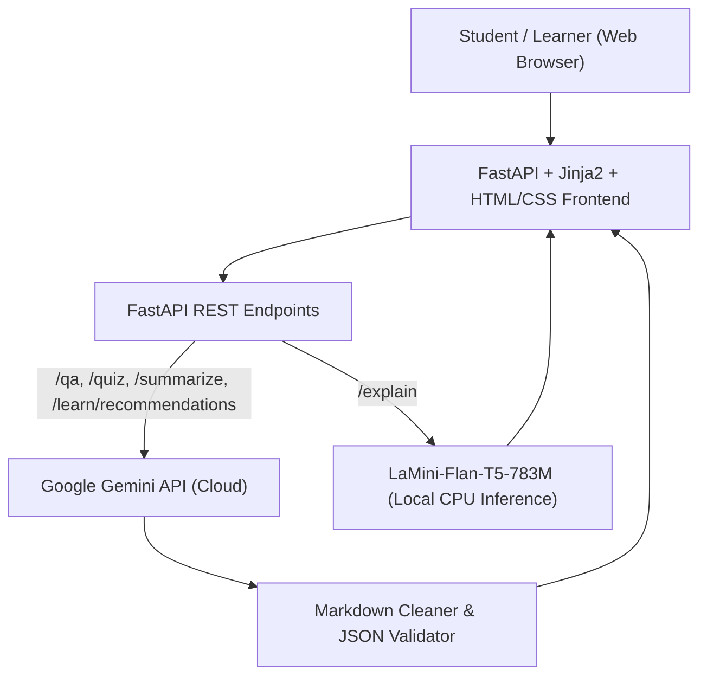

# 🧞 EduGenie: Google Gemini Powered Learning Assistant

**EduGenie** is a lightweight, AI-powered educational assistant designed for students, educators, and self-learners across all academic levels. It leverages a dual-AI architecture combining **Google Gemini** for high-reasoning tasks with the local instruction-tuned **LaMini-Flan-T5-783M** model for fast, CPU-friendly concept simplification.

---

## 🌟 Key Features

EduGenie delivers five core learning functions:

1. **❓ Question and Answer (`/qa`)**
   * Students can ask academic or general knowledge questions (e.g., *"Which is the largest ocean?"*).
   * Powered by Google Gemini to generate clear, concise, and contextual answers with structured explanations.

2. **💡 Concept Explanation (`/explain`)**
   * Students enter any topic or concept (e.g., *"Photosynthesis"*, *"Newton's Third Law"*).
   * Uses the lightweight local **LaMini-Flan-T5-783M** model on CPU to simplify concepts using everyday analogies without overwhelming beginners.

3. **📝 Interactive Quiz Generation (`/quiz`)**
   * Automatically generates **exactly 3 multiple-choice questions (MCQs)** with **4 options each** from any topic or passage.
   * Cleans AI Markdown code blocks (` ```json `) and parses strict JSON.
   * **Interactive Web Interface**: Live scoring, instant feedback, and when an incorrect option is chosen, the UI **clearly highlights the correct answer in green** with an explanation.

4. **📄 Educational Summarization (`/summarize`)**
   * Paste long textbooks, articles, or lecture notes.
   * Google Gemini condenses the text into a quick-revision summary with an overview, core key points, and revision takeaways while eliminating unnecessary fluff.

5. **🗺️ Personalized Learning Path (`/learn/recommendations`)**
   * Enter any subject (e.g., *"SQL"*, *"Data Science"*, *"Calculus"*) and target level (*Beginner*, *Intermediate*, or *Advanced*).
   * Generates a step-by-step roadmap in increasing order of difficulty with timelines, curated resources (books, videos, articles), and milestone projects.

---

## 🏗️ System Architecture



### Dual-Model Breakdown

| Model | Deployment | Purpose | Key Advantages |
|---|---|---|---|
| **Google Gemini** | Cloud API | Q&A, Quizzes, Summaries, Learning Paths | Advanced reasoning, structured JSON generation, up-to-date knowledge |
| **LaMini-Flan-T5-783M** | Local (CPU) | Concept Explanation | Instruction-tuned, lightweight (~783M parameters), runs offline on CPU |

---

## 📁 Project Folder Structure

```text
EduGenie/
├── main.py                     # FastAPI application & REST endpoint routing
├── explanation_module.py       # Concept explanation logic (LaMini-Flan-T5-783M)
├── qna.py                      # Question-answering logic (Google Gemini)
├── quiz_module.py              # Quiz-generation logic (Gemini + JSON validation)
├── summary_module.py           # Summarization logic (Google Gemini)
├── learning_path.py            # Personalized learning recommendations (Gemini)
├── gemini_service.py           # Resilient Gemini API client & markdown parser
├── test_edugenie.py            # Unit test suite verifying all 5 core functions
├── templates/
│   └── index.html              # Clean, responsive Jinja2 HTML interface
├── static/
│   └── style.css               # Modern, accessible styling
├── requirements.txt            # Python dependencies
├── .env.example                # Template for environment configuration
└── README.md                   # Full documentation & setup guide
```

---

## 🚀 Prerequisites and Setup

### 1. Requirements
* **Python 3.10 or newer**
  ```bash
  python --version
  ```
* A **Google Gemini API Key** from [Google AI Studio](https://aistudio.google.com/).

### 2. Installation

1. **Clone or navigate to the project directory**:
   ```bash
   cd EduGenie
   ```

2. **Create and activate a virtual environment**:
   ```bash
   # Windows (PowerShell)
   python -m venv venv
   .\venv\Scripts\Activate.ps1

   # Linux / macOS
   python3 -m venv venv
   source venv/bin/activate
   ```

3. **Install the dependencies**:
   ```bash
   pip install -r requirements.txt
   ```

4. **Configure your API Key**:
   Copy `.env.example` to `.env` and insert your Gemini API Key:
   ```bash
   # Windows
   copy .env.example .env

   # Linux / macOS
   cp .env.example .env
   ```
   Edit `.env`:
   ```env
   GEMINI_API_KEY=your_gemini_api_key_here
   GEMINI_MODEL=gemini-2.5-flash
   ```

   *(Note: You can also configure the API Key directly in the web UI using the "Config" modal in the top header).*

---

## 💻 Running the Application

Start the FastAPI application with Uvicorn:

```bash
uvicorn main:app --reload
```

Then open your browser and navigate to:
```
http://127.0.0.1:8000
```

---

## 🧪 Functional Testing Checklist

You can verify all major features using the web UI or the automated test suite:

### Automated Tests
Run the built-in test suite:
```bash
python test_edugenie.py
```

### Manual Testing Scenarios
1. **Question & Answer**: Select **❓ QnA**, enter *"Which is the largest ocean?"*, and verify that an accurate, concise answer is returned.
2. **Concept Explanation**: Select **💡 Explain**, enter *"Photosynthesis"*, and verify that a beginner-friendly explanation with analogies is generated by the local model.
3. **Quiz Generation**: Select **📝 Quiz**, enter *"Pythagoras Theorem"*, click Submit.
   * Verify that **exactly 3 questions** with **4 options each** appear.
   * Click an option: if wrong, the chosen option is highlighted in red, and the **correct answer is clearly highlighted in green**.
4. **Summarization**: Select **📄 Summary**, paste a paragraph of textbook notes, and verify that key takeaways and revision points are generated.
5. **Personalized Learning Path**: Select **🗺️ Recommend Path**, enter *"SQL"*, select *"Beginner"*, and verify a progressive roadmap from beginner to advanced with timeline and recommended books/tutorials.

---

## 📡 REST API Reference

### `POST /qa`
**Request Body**:
```json
{
  "question": "Which is the largest ocean?"
}
```
**Response**:
```json
{
  "success": true,
  "question": "Which is the largest ocean?",
  "answer": "The Pacific Ocean is the largest and deepest ocean on Earth...",
  "model": "gemini-2.5-flash"
}
```

### `POST /explain`
**Request Body**:
```json
{
  "topic": "Newton's Third Law"
}
```
**Response**:
```json
{
  "success": true,
  "topic": "Newton's Third Law",
  "explanation": "Newton's Third Law states that for every action, there is an equal and opposite reaction...",
  "model": "MBZUAI/LaMini-Flan-T5-783M"
}
```

### `POST /quiz`
**Request Body**:
```json
{
  "topic": "Pythagoras Theorem"
}
```
**Response**:
```json
{
  "success": true,
  "input": "Pythagoras Theorem",
  "quiz": [
    {
      "id": 1,
      "question": "In a right-angled triangle, which formula represents the Pythagorean theorem?",
      "options": ["a² + b² = c²", "a + b = c", "a² - b² = c²", "2a + 2b = c"],
      "correct_option_index": 0,
      "correct_answer": "a² + b² = c²",
      "explanation": "The square of the hypotenuse (c) equals the sum of the squares of the other two sides (a and b)."
    }
  ],
  "model": "gemini-2.5-flash"
}
```

### `POST /summarize`
**Request Body**:
```json
{
  "text": "Mitochondria are membrane-bound cell organelles that generate chemical energy (ATP)..."
}
```

### `POST /learn/recommendations`
**Request Body**:
```json
{
  "topic": "SQL",
  "level": "Beginner"
}
```

---

## 🛡️ Error Handling & Reliability

* **Markdown Code Fence Stripping**: Cleans ` ```json ` markers before JSON parsing to avoid syntax crashes.
* **Resilient Quiz Recovery**: If an LLM returns slight formatting variations, regex fallbacks extract the valid quiz questions.
* **Offline Local Model Fallback**: If local weights are downloading or Hugging Face dependencies are initializing, EduGenie provides structured guidance without crashing.
* **Missing API Key Notifications**: Clear instructions appear if a user hasn't set their key yet.

---

## 🔮 Future Enhancements

The modular design supports future extensions:
* 🎙️ **Voice-Based Interaction**: Hands-free Q&A via Web Speech API or Gemini Live API.
* 🌐 **Multilingual Support**: Real-time translation of explanations and summaries.
* 📱 **Mobile & Offline PWA**: Offline quiz taking and synchronized study decks.
* 📊 **Student Progress Analytics**: Mastery tracking, streak counts, and gamified badges.
* 📷 **Snapshot Doubt Solver**: Image input for solving math or science problems from textbook photos.
